<a href="https://lofi-studio-one.vercel.app"><picture><source media="(prefers-reduced-motion: reduce)" srcset="docs/readme/hero-still.webp">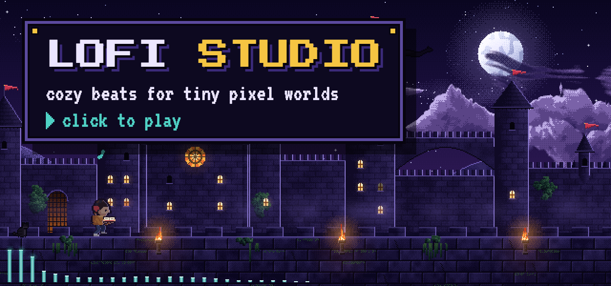</picture></a>

<h3 align="center">Pick a vibe and a tiny band starts playing.</h3>

Lofi Studio makes lo-fi music live in your browser, each vibe in a little pixel world of its own. No samples, no AI model, no sign-up and nothing to install.

&nbsp;&nbsp;<a href="https://github.com/rader-ai/lofi-studio/generate">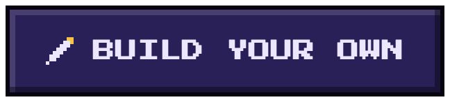</a>

 

<h2>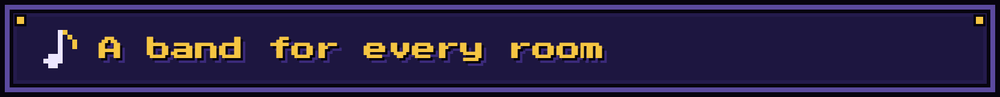</h2>

Eight vibes, eight places, eight bands. Swipe from the castle wall to the rainy office and a boom bap Rhodes gives way to felt piano and deep sub bass. Swipe again and a jazz trio picks up in the coffee shop. The weather, the birds and the lights are painted live in code, and the little monitors and torches react to what's playing.

<table>
<tr>
<td width="50%" valign="top"><a href="https://lofi-studio-one.vercel.app"><picture><source media="(prefers-reduced-motion: reduce)" srcset="docs/readme/world-castle-still.webp">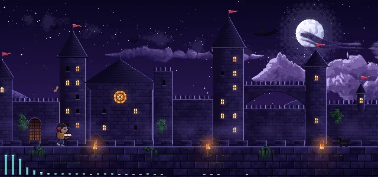</picture></a> <b>Late Night Study</b> Boom bap on a Rhodes while a wanderer walks the castle wall.</td>
<td width="50%" valign="top"><a href="https://lofi-studio-one.vercel.app"><picture><source media="(prefers-reduced-motion: reduce)" srcset="docs/readme/world-office-still.webp">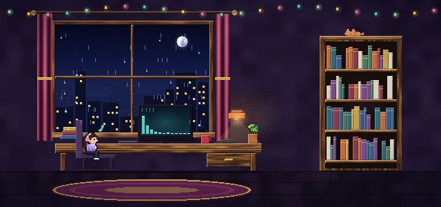</picture></a> <b>Rainy Window</b> Felt piano and deep sub bass at the desk, with rain on the glass.</td>
</tr>
<tr>
<td valign="top"><a href="https://lofi-studio-one.vercel.app"><picture><source media="(prefers-reduced-motion: reduce)" srcset="docs/readme/world-cafe-still.webp">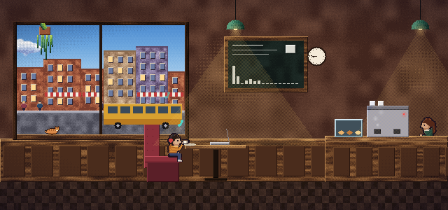</picture></a> <b>Coffee Shop Jazz</b> Brushes, ride cymbal and walking bass from the good booth.</td>
<td valign="top"><a href="https://lofi-studio-one.vercel.app"><picture><source media="(prefers-reduced-motion: reduce)" srcset="docs/readme/world-garden-still.webp">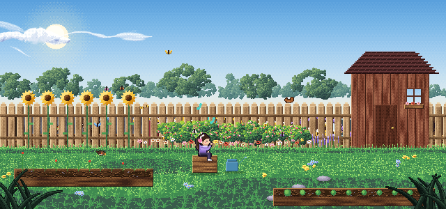</picture></a> <b>Sunday Morning</b> Nylon guitar, claps and shaker, with birds dropping in on the fence.</td>
</tr>
<tr>
<td valign="top"><a href="https://lofi-studio-one.vercel.app"><picture><source media="(prefers-reduced-motion: reduce)" srcset="docs/readme/world-forest-still.webp">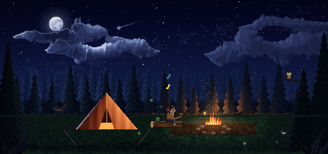</picture></a> <b>Neo-Soul Groove</b> A Wurlitzer, a lazy snare and a buzzy synth bass around the campfire.</td>
<td valign="top"><a href="https://lofi-studio-one.vercel.app"><picture><source media="(prefers-reduced-motion: reduce)" srcset="docs/readme/world-lake-still.webp">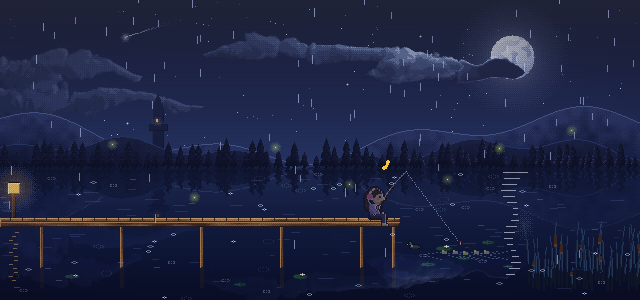</picture></a> <b>Sleepy Ambient</b> No drums. Floaty keys and soft rain on a moonlit dock.</td>
</tr>
<tr>
<td valign="top"><a href="https://lofi-studio-one.vercel.app"><picture><source media="(prefers-reduced-motion: reduce)" srcset="docs/readme/world-park-still.webp">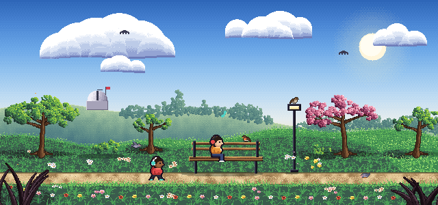</picture></a> <b>Old Tape Memories</b> Bossa nova on an organ, warped by old tape, from a park bench.</td>
<td valign="top"><a href="https://lofi-studio-one.vercel.app"><picture><source media="(prefers-reduced-motion: reduce)" srcset="docs/readme/world-beach-still.webp">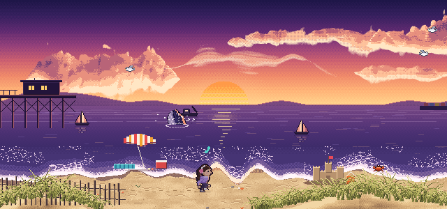</picture></a> <b>Bittersweet</b> A waltz in 3/4 on felt piano, walking the sand at sunset.</td>
</tr>
</table>

**Try another** plays a new song in the same vibe: a new melody, and often a different groove, bass line or lead. Vibraphone, flute, music box, guitar and a soft synth all take turns up front.

 

<h2>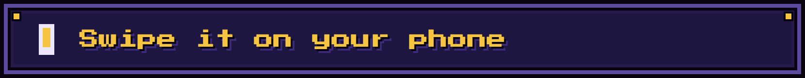</h2>

<a href="https://lofi-studio-one.vercel.app"><picture><source media="(prefers-reduced-motion: reduce)" srcset="docs/readme/phone-still.webp">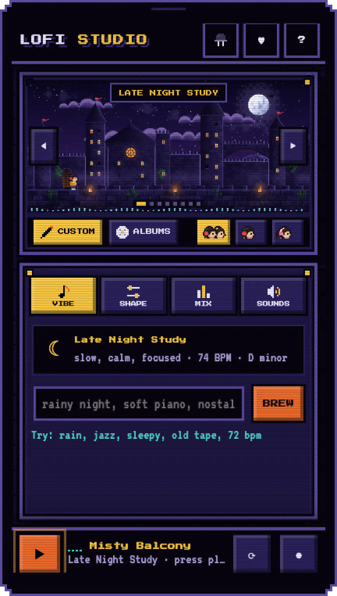</picture></a>

The whole studio fits on one screen, and nothing scrolls.

**Swipe the scene** to change the vibe. The music and the world change together.

**Custom** is your own track. Describe a vibe in words, then shape it, mix it and add your own sounds.

**Albums** takes over the screen. The scene becomes the album's world, the panel becomes its tracklist, and swiping moves from album to album. Switch back and your own track is still there.

**LED mode** keeps every light steady, for anyone who'd rather not see them flash with the beat.

 

 

<h2>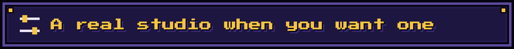</h2>

<a href="https://lofi-studio-one.vercel.app"><picture><source media="(prefers-reduced-motion: reduce)" srcset="docs/readme/desktop-still.webp">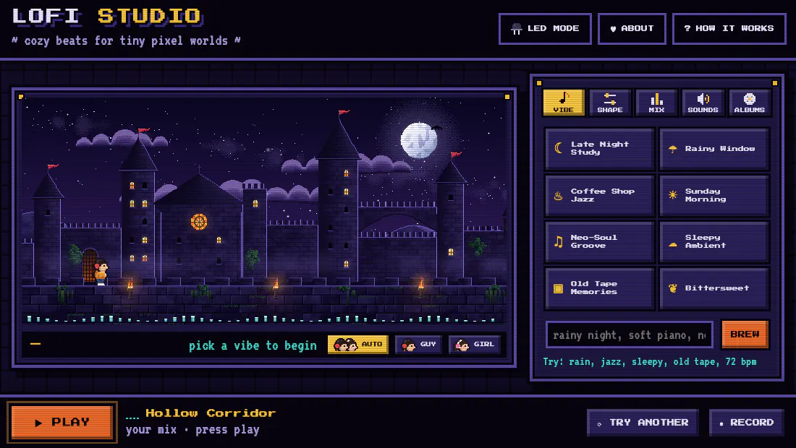</picture></a>

Everything changes while it plays.

- **Shape:** drag speed, bounce, vintage and space, then pick the key, chords, groove and the instrument on the keys.
- **Mix:** turn any part on or off and set its level. Turn on the rain and it starts raining in the scene.
- **Describe:** type *rainy night, soft piano, 72 bpm in A minor* and hit BREW. It knows grooves and instruments by name, so *bossa nova on an old organ* works too.
- **Sounds:** drop in your own audio. Loops stretch to the tempo, vocal chops follow the chords, and your own kick, snare and hi-hat replace the built-in ones.
- **Record:** save what you hear as a `.webm` file.

 

<h2>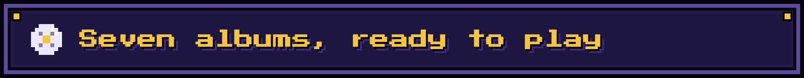</h2>

42 songs and about an hour and a half of music, ready to play from start to finish. Each album lives in its own world, and each track is a fixed recipe, so it plays the same song every time. Any cover downloads as a 1200×1200 PNG.

<a href="https://lofi-studio-one.vercel.app">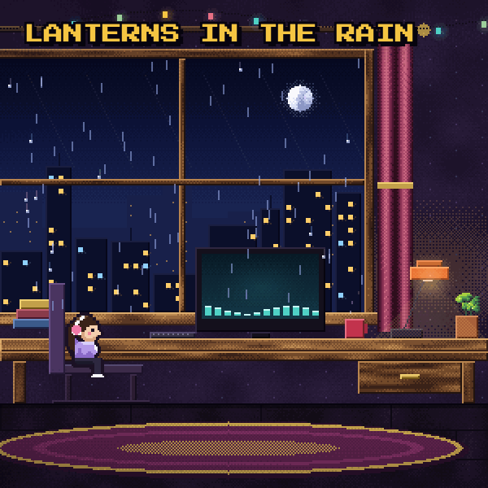</a> <a href="https://lofi-studio-one.vercel.app">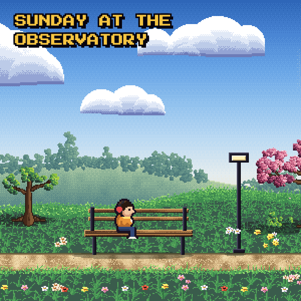</a> <a href="https://lofi-studio-one.vercel.app">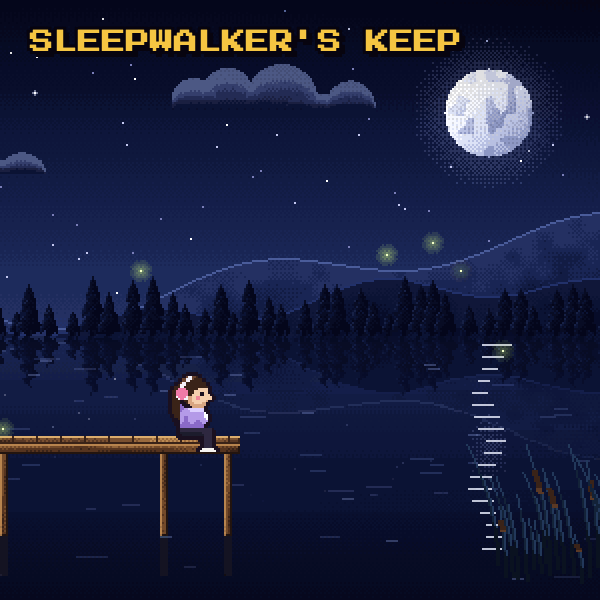</a> <a href="https://lofi-studio-one.vercel.app">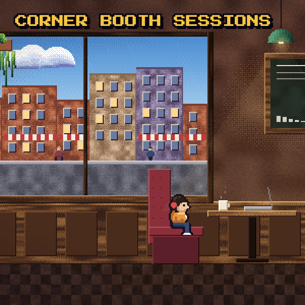</a> <a href="https://lofi-studio-one.vercel.app">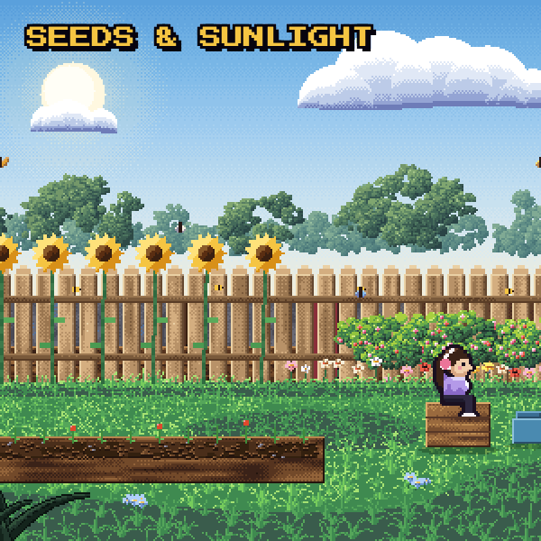</a> <a href="https://lofi-studio-one.vercel.app">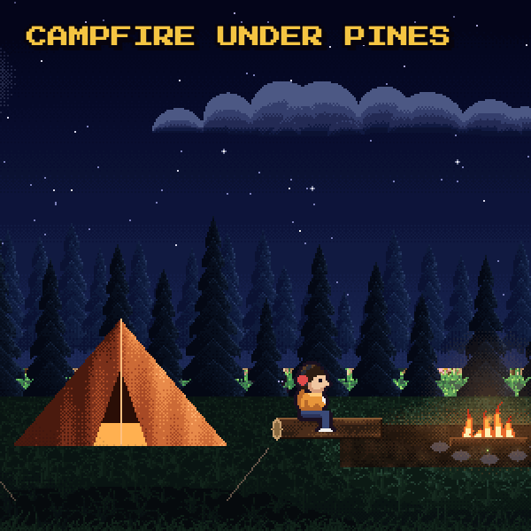</a> <a href="https://lofi-studio-one.vercel.app">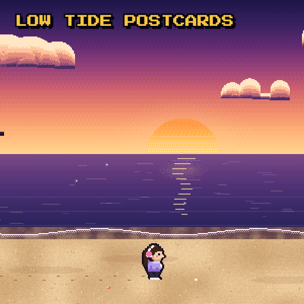</a>

 

<h2>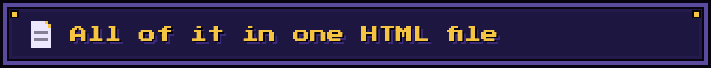</h2>

Open `index.html` and it's all there: about 5,200 lines, no framework and no build step. The page loads [Tone.js](https://tonejs.github.io/) and two pixel fonts, and that's all it needs.

- **The music** comes from a small step sequencer and synths built on Tone.js. Each chord progression has a style that sets its groove, drum kit, comping, bass line and choice of lead.
- **The worlds** are painted in code with a small hi-bit toolkit: hue-shifted color ramps, ordered dithering, grass that leans with the wind, and birds that land and take off.

Everything moving on this page was captured from the running app. `docs/readme/tools/make.sh` rebuilds it all.

 

<h2>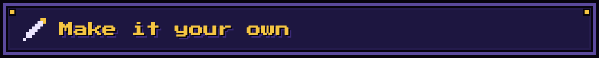</h2>

The code is yours to build on, under the [MIT license](LICENSE): change it, ship it, even sell it. Just keep the `LICENSE` file with your copy.

1. Click **Use this template** for a fresh repo of your own, or **Fork** if you'd like to suggest changes back here.
2. Serve the folder with any static server, like `npx serve`, and open it in a browser. There's no build step, so edit and refresh. Opening `index.html` directly works too, but browsers block the guitar's plucked strings there, so it falls back to felt piano.
3. Put it on any static host, like Vercel, Netlify or GitHub Pages.

A copy still points to this one, so before you share yours, please give it its own name and change these:

- **Name:** search `index.html` for `Lofi` and `LOFI`. The splash screen's logo is drawn in pixels (`.sp-logo`), so replace that too.
- **Address:** search for `lofi-studio-one.vercel.app`. That's the page address and the link-preview image.
- **Credits:** search for `Chris Rader`, `rader-ai` and `happyrader`. That covers the header credit, the page details and the About box (name, photo and links).
- **Images:** replace `og.png` (the link preview), `favicon.svg`, `favicon-32.png` and `apple-touch-icon.png`. You can delete `docs/readme`, which only holds this page's pictures.

 

Made by <a href="https://happyrader.com">Chris Rader</a> (<a href="https://github.com/rader-ai">@rader-ai</a>). Sound by <a href="https://tonejs.github.io/">Tone.js</a>. Fonts are Press Start 2P and VT323. <a href="LICENSE">MIT license</a>. Tone.js (MIT) and the fonts (SIL Open Font License) have their own licenses and load from public CDNs.

